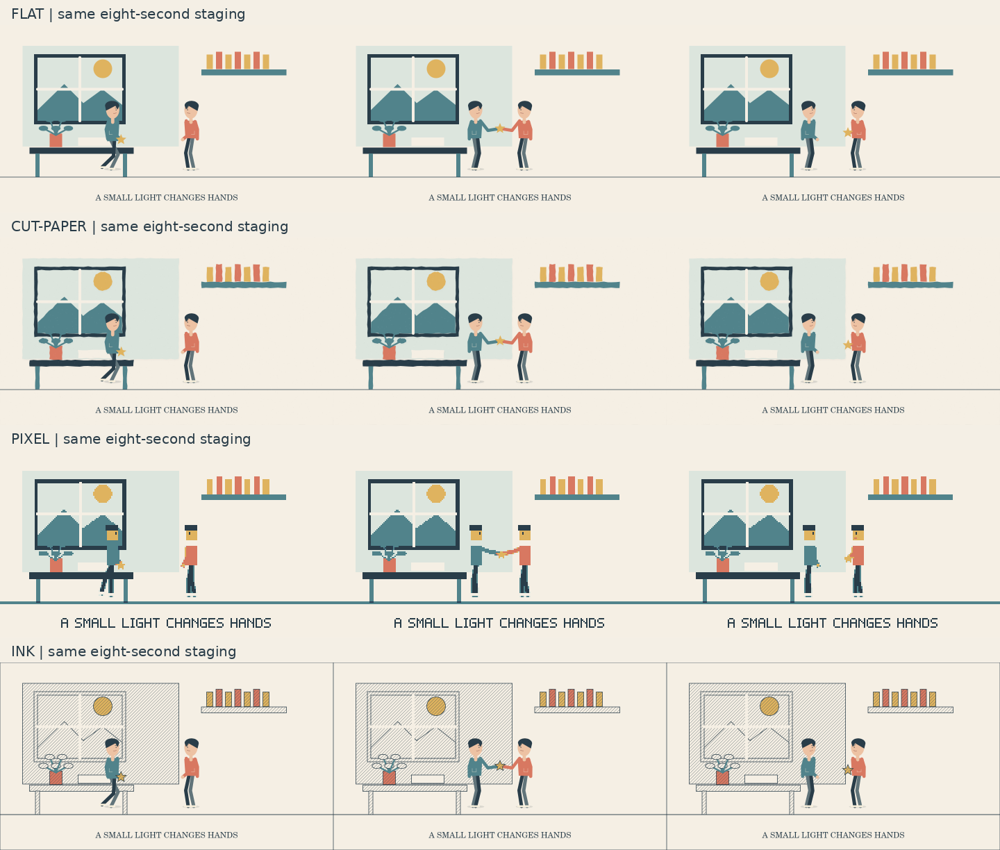

# MV 创作导演 · storybook-mv

通过分轮提问确认需求，再形成方案、制作样片并检查成片的 Agent Skill。当前版本：**3.6.1**。最新变化见 [3.6.1 更新内容](#361-更新内容)。

不预设画风、人物比例、配色、画面比例或渲染引擎。支持叙事、人物动画、文字、抽象图形和其他适合项目的方向；素材政策由项目确定。

## 让其他 agent 安装

把本仓库地址和下面的指令一起发给编程 agent：

> 请获取这个仓库，先读取 `skills/storybook-mv/SKILL.md`，检查完整性后，将 `skills/storybook-mv/` 完整目录安装到当前工具支持的 Skills 目录，保留 scripts、references、assets 和许可证。若当前工具不支持 Skills 自动发现，则保留在项目中，并在开展相关任务前读取 SKILL.md。先完成安装，选定制作路线后再检查和安装对应依赖。使用时先复用已确认的信息，通过每轮 1—3 个关键问题确定需求，方向明确后只进入设计；先展示完整脚本与实际设计图，等待验收，再依次展示限定样片和全曲粗剪，各阶段经使用者确认后才进入下一步。AI 自检不能替代使用者验收。

不要只下载 `SKILL.md`；脚本、参考和素材目录都是技能的一部分。目标目录已经存在时，先比较版本并保留已有修改。

| 环境 | 安装目录 | 调用方式 |
|---|---|---|
| Codex CLI / IDE | `~/.agents/skills/storybook-mv/` 或项目的 `.agents/skills/storybook-mv/` | `$storybook-mv` |
| Claude Code | `~/.claude/skills/storybook-mv/` 或项目的 `.claude/skills/storybook-mv/` | `/storybook-mv` |
| 其他支持 Agent Skills 的工具 | 按宿主工具文档配置 | 读取完整目录中的 `SKILL.md` |
| 不支持 Skills 的 agent | 放入可访问的项目目录 | 每次相关任务先读取技能及必要参考 |

具体平台的安装机制与远程会话共享能力可能不同；本地安装不会自动同步到其他产品。平台说明与来源见 [交接参考](skills/storybook-mv/references/agent-interop.md)。

## 硬约束：先理解歌曲并确认具体内容

**一轮基础题答完，不代表可以开始制作。** 歌名、时长、画幅和画风只是基础信息。AI 必须继续确认具体表现什么、如何发展、有哪些关键画面，并复述内容让使用者确认。确认前只做澄清、参考分析、查证和方案讨论。

有歌词的歌曲须先阅读实际提供或核实的歌词，区分作者公开说明、文本解读和用户改编。不能凭歌名或印象编歌词、编本意。关键含义存在分歧时，给出有依据的不同方向，让使用者选定；事实查不到就保留未知。

制作还须有明确范围：同意短样片不能自动扩大成全曲。脚本会检查内容确认记录、所选歌曲理解和时长上限；旧项目缺少确认记录时不会自动放行。记录必须来自真实用户回复，不能为了通过检查自行填成“已确认”。

## 默认运行流程

**方向确认只放行设计，AI 自检通过不等于使用者验收通过。**

| 阶段 | 必须展示的内容 | 确认后放行 |
|---|---|---|
| 提问与歌曲理解 | 依据歌词/录音的理解、具体内容方向与限制 | 设计与脚本 |
| 设计与脚本 | 完整目标范围的分镜、实际设计帧、字幕与转场示意、明确的样片区间 | 限定样片 |
| 样片 | 实际可播放片段、关键动作/效果、转场与同步，以及已知不足 | 全曲粗剪 |
| 全曲粗剪 | 简化画面配整首歌，检查重复、副歌变化、节奏、发展与结尾 | 精细制作 |
| 精细制作 | 经过实际导出检查的成片、源码与局限 | 交付并局部修订 |

每次展示后应结束当前轮次并等待回复。“继续”只适用于当前已展示的稿件和下一阶段；先前的完整 MV 目标不能接受尚未出现的稿件。每阶段记录绑定实际文件、版本和真实回复。仅在使用者明确指定时允许有限地跳过某个验收，仍须完成和检查对应工作。

制作入口增加独立设计阶段（只允许静态图）、获准样片区间检查、全曲粗剪范围与低成本规格检查，以及旧项目/跨 agent 的阶段恢复。正常修错无需重问创意方向；实质改动回到受影响的验收点。详细规则见 [逐阶段验收](skills/storybook-mv/references/user-stage-review.md)。

## 3.6.1 更新内容

发布日期：**2026-10-30**。本版加强实际美术设计与对照修改的方法，沿用已有设计 → 样片 → 全曲粗剪 → 成片验收流程。

| 加入的规则 | 实际要求 |
|---|---|
| 喜欢与不喜欢的参考一起分析 | 复用已有参考和拒绝理由，拆出轮廓、构图、留白、色彩、文字与动作等可见特征；数量按需要调整，不为了填表重复提问 |
| 先建立可复现的基准图 | 在设计阶段用实际制作资产和渲染器画代表画面；人物叙事可用近景、双人构图、环境远景，无人物作品按实际题材调整；未决方向用同内容的少量受控版本比较 |
| 复用已选定的美术资产 | 保存角色/图形/文字/场景资产的来源、版本、基准及受影响镜头；反复达不到要求时展示证据，提出具体调整或小范围真人美术检查的选择，付费、联系与素材政策变更仍由使用者授权 |
| 先看完整范围的画面关系 | 把关键画面按已确认范围整理成静态色彩与构图总览，检查焦点、景别、密度、呼应和有意重复；该总览与原设计包一起审看，之后仍须检查真实配乐粗剪 |
| 每轮优先修具体问题 | 把“更精致”转成看得见的缺陷，通常优先处理影响最大的三项，保留完整问题清单与修改前后对照，并积累按项目限定的真实偏好记录 |

新增可选的[项目工作记录模板](skills/storybook-mv/assets/contracts/art-direction.template.json)，用于 `plan/art-direction.json`。参考、基准图、素材使用、画面总览和修改记录由 agent 整理；补充审美备注不改写已经验收绑定的设计文件。实际设计或源码改变仍需新修订、相应检查和受影响阶段的验收。

本地 207 项回归检查通过，独立的八秒无人物纯代码静态设计包完成实际出图；交接命令重新渲染的三张基准图均与原图逐字节一致，项目仍停在待审阅的 design 阶段。

详细方法见 [美术基准与对照修改](skills/storybook-mv/references/art-direction.md)，验证范围见 [3.6.1 记录](skills/storybook-mv/assets/verification-v361.json)。这些是制作工作方法与记录约定，不是自动审美评分、模型训练或画面质量保证；原有 3.6 工作台和渲染器继续使用。

## 3.6 更新内容

发布日期：**2026-10-30**。本版把七类制作工具整合成一个离线中文导演工作台，共用角色、场景、镜头和歌词数据，支持保存后重新打开并继续编辑。

| 新增模块 | 已实现的操作 |
|---|---|
| 动作与表演 | 调整视线、头部、重心和手脚目标，编辑关键姿态及衔接方式，设置简单脚底固定和接触区间，查看接触距离 |
| 场景与镜头 | 拖动图层构图，管理前后层级、位置、缩放和旋转，复用或复制场景，编辑摄影机平移与缩放关键帧 |
| 歌词时间轴 | 载入所选录音及波形，导入 LRC / SRT / JSON，拖动与调整歌词行时间，手动分割词段并导出时间草稿 |
| 分镜粗剪 | 拆分、重排镜头和调整相邻镜头时长，保持完整目标时长，在获准阶段查看简化动态预览 |
| 转场 | 并排查看 A/B 实际画面，调整切换、叠化、擦除及两点位置匹配转场 |
| 素材与风格 | 编辑共享角色、形状、文字与配色，导入已有像素角色数据，复制、替换、导出素材并查询受影响的镜头 |
| 审片与局部修复 | 绑定实际视频版本，对照播放、记录时间点意见，导出片段相对时间批注及带相邻余量的局部修复计划 |

### 保存、接回制作与修复

- 工作台 JSON 支持保存、重新载入和继续修改；保留原有像素工作台，像素角色可导入统一场景。
- 新修订可接回选定的 **Canvas2D 或 Remotion** 项目，复用同一份绘制核心；采用前备份原有入口和辅助文件，写入失败时回滚。
- 核对工作台基线、当前项目源文件及已展示设计源，防止旧编辑覆盖新内容；保存或导入数据不会提升制作阶段或生成用户验收。
- 审片意见绑定原视频校验值和全局片段范围；兼容 WebM 预览仍指向原始 MP4，导出意见时保留正确的片段相对时间。
- 修复 Windows 临时目录短名称造成的路径误判；统一解析项目路径，同时继续拒绝越出项目目录的文件。
- 修正歌词导入区标签被挤成竖排，以及输入提交与界面刷新可能丢失编辑的问题。

创建项目的静态设计工作台：

```bash
python3 skills/storybook-mv/scripts/director_workbench.py init --project <项目目录> --out plan/director-design-r1
```

打开生成的工作台并保存编辑后的 JSON；后续采用、渲染和设计 → 样片 → 全曲粗剪 → 成片验收流程见 [导演工作台说明](skills/storybook-mv/references/director-workbench.md)。

### 已完成的验证

- 本地 **206 项回归检查通过，零跳过**；更新后的 Windows 检查运行 206 项，其中 3 项因缺少可选字体而跳过。
- 真实浏览器操作覆盖七模块编辑、保存与重新打开、受限动态播放、窄屏布局和绑定原片的时间点反馈；另完成独立的原创六秒工作台使用验证。
- Canvas2D 与 Remotion 均实际导出全局 **第 2–4 秒**的视频，完成完整解码，并核对原创合成音轨在片段内 **0.5 / 1.5 秒**的信号位置；下载后的 CI 文件和视频也完成校验。
- [3.6 更新已合并，五项 GitHub 检查均已通过](https://github.com/wjy139331916-bit/storybook-mv/pull/6)。具体测试版本、运行环境、文件校验值和范围见 [3.6 验证记录](skills/storybook-mv/assets/verification-v36.json)。

### 仍有的边界

内置构造角色用于搭建动作，复杂人物表演仍为 **partial**，需要逐镜调校。歌词时间与手动词段是草稿，真实演唱同步须听辨复核。其他绘画、3D 或自定义引擎需要各自适配器；窄屏浏览器模拟不代表 Android 真机已验证。工具检查与原创示例均不能替代使用者对实际作品的验收。

## 3.5：像素角色工作台与所选制作路线

- 可离线编辑像素角色部件、调色板、姿势与脚底/持物基准；导出可编辑数据及静态设计图，设计验收后才开放动作播放与精灵图。
- 自测先诊断所选依赖；支持按需安装、工具自有目录重试和新修订，保留已有项目。
- 记录所选 Python、关键包、平台、架构、浏览器和编码器版本；六秒中文探针核对真实字形与导出视频中的描色变化。
- 增加真实 p5.brush 软件渲染探针、浏览器采样估算、原创叙事信息卡、中文位图字图集导出及绑定实际镜头的表演计划。
- Remotion 从指导路线升级为可选可执行模板，所有制作入口继续服从现有分阶段验收。已在标准 Ubuntu 宿主完成实际 MP4 导出、完整解码、非零 [2,4] 片段与合成音轨检查；具体版本和证据见验证记录。本地沙箱仍可能限制其网卡信息/回环访问。
- 3.5 发布时的本地 175 项回归测试通过，零跳过。真实 Linux 浏览器编辑、中文和原生/软件渲染的范围见 [3.5 验证记录](skills/storybook-mv/assets/verification-v35.json)，不代表 Android 或复杂人物表演已验收。

像素工具无需单独安装桌面绘图软件：

```bash
python3 skills/storybook-mv/scripts/pixel_workbench.py init --project <项目目录> --out assets/pixel/actor-r1
```

打开生成的工作台，保存修改后的数据；先展示实际角色设计和完整脚本，验收通过后才制作动作。默认造型只是可修改的原创构造示例。详见 [工作台](skills/storybook-mv/references/pixel-workbench.md)、[Remotion 适配](skills/storybook-mv/references/remotion-adapter.md)、[表演与叙事组件](skills/storybook-mv/references/production-assets.md)。

## 3.4：补漏检，统一审片与交接

保留原有三个审片验收点，不增加确认轮数。由 agent 整理技术记录，使用者查看实际作品并回复意见。

| 改进 | 实际行为 |
|---|---|
| 样片不能缩水或换区间 | 验收包重新核对视频实际时长、完整获准样片区间、画幅及音轨身份；约定 6 秒的样片不能用 2 秒视频过审 |
| 必检项不能填“不适用”放行 | 项目选定的接触、动作等必检项需要实际检查；有意静止应审看其作用 |
| 动态结论需要动态证据 | 动作、表演、接触及转场等需要视频或绑定原视频的连续帧，以及实际审看的时间范围 |
| 一处审看作品 | 同页展示完整脚本、实际设计图或视频、版本、已知不足与下一阶段；审片页不会自行批准制作 |
| 跨 agent 状态卡 | 自动推导当前阶段、已确认版本、待修改事项与已知限制；卡片不能替代真实回复和稿件 |
| 播放兼容与时间点反馈 | 可按需生成同时间轴 WebM 预览并保留原视频；反馈绑定原视频版本，作为待处理意见导入 |

使用 [审片工作区](skills/storybook-mv/references/review-workspace.md) 的 `review_workspace.py present / accept / status / handoff` 整理稿件与真实验收。工具只自动填写机械字段，不能判断或伪造用户同意。对照已认可的设计图检查制作效果，避免无声降低画面质量。

新增三类原创 12 秒机制探针：人物递物、中文文字画面、抽象图形。它们使用代码与原创器乐，展示有限机制，不代表已经完成真实演唱歌曲 MV 或自然人物表演。[验证方法](skills/storybook-mv/references/creative-validation.md) · [3.4 实测记录](skills/storybook-mv/assets/verification-v34.json)


## 保留的输入与执行检查

- 歌词解读绑定实际歌词文件、可追溯行号和来源快照；作者本意需有已检查的原始来源。
- 内容确认绑定真实用户回复和方案版本；规划状态、缺失音频、错误音轨与过期记录会拦截制作。
- Python 与 JavaScript 制作入口共用同一套校验，修复数值表示导致的确认误判和非横屏画幅错误。
- 整曲精细制作前同时检查实际样片的技术记录，以及设计、样片和全曲粗剪的使用者验收；完整字幕检查漏句、重复、顺序、文本、复核状态和所选中文字体的实际字形覆盖。
- 原生 Canvas 支持时间范围导出、校验后的断点续渲染、实测耗时/缓存估算与预算上限。

这些检查不能认证伪造的用户回复、代替理解歌词或保证审美。具体协议见 [执行检查](skills/storybook-mv/references/execution-gates.md)、[局部渲染](skills/storybook-mv/references/native-incremental.md) 和 [能力状态](skills/storybook-mv/assets/capability-matrix.json)。相关记录由 agent 根据实际对话和文件填写，无需让使用者回答哈希或 JSON 问题。

## 能做什么

- 自适应提问、参考分析、可行性取舍和具体方案。
- 同内容的风格对照，以及可复用的扁平、纸艺、像素和线描代码画法；可继续扩展新风格。
- 参考片测量、原生画法拆解、参考画面与实际渲染并排对照。
- 项目视觉规范，统一角色、图形、文字和运动语言。
- 可选的表情、视线、动作与转场组件；歌词物件的意义、呼应和衔接设计。
- 音乐段落与分镜映射、带复核状态的节拍候选、LRC / SRT 导入。
- 解码画面的静止/黑帧/切点候选检查、声明布局与姿势检查、音轨偏移和响度测量。
- 本地看片播放器，支持对照播放、片段循环和按视频校验值绑定的时间点反馈。
- 时间点问题记录、样片检查、共享素材修复范围和定点返工。
- 完整目录导出、文件校验和可播放的 Canvas2D 运行自检。

## 完整性检查

下载后在仓库目录运行：

```bash
python3 skills/storybook-mv/scripts/verify_portable.py skills/storybook-mv
```

这验证导出文件及版本，不代表运行环境或艺术效果已经通过。

## 制作依赖

规划阶段不需要安装所有渲染工具。制作入口使用 Python 3 的统一校验，使用者项目的实际设计图验证还需要 Pillow（见 `scripts/requirements-media.txt`）；JavaScript 渲染项目也需要 Python，可用 `MV_PYTHON` 指定解释器。先确定方案和一个主要引擎，再按需准备依赖：

- `canvas2d`：内置空白 Canvas2D 项目，可选择浏览器或可选的 Node Canvas 运行方式。
- `painted-p5`：内置 p5.js / p5.brush 模板，需要对应包、Chrome、FFmpeg 等依赖。
- `remotion`：新增可选原生项目模板及阶段受控的静态图、限定片段、估算和视频导出适配；依赖另行安装。
- three.js、Blender 和自定义路线：提供选型指导，需要另行实现与验证适配器。

中文项目需要可用的本地中文字体，并检查真实字形。运行方式、版本、自检与验证范围见 [运行参考](skills/storybook-mv/references/runtime-portability.md)。技能不会自行开通付费服务、替换音乐或发布作品。

## 示例与验证范围



上图是受控实现对照，用来比较处理方式；实际作品需要自己的角色、构图、场景和动作设计。示例不限定可选风格。

版本 3.0.0 增加四种可执行画法、原创完整 30 秒示例、成片与音轨检查工具，以及随仓库分发的回归测试。所有示例都使用原创代码、测试文字和程序合成音乐，不包含个人照片或原歌曲音频。

3.4 已实际运行原生 Canvas 的三类原创机制，以及 Linux Chromium 134 的 Canvas2D 画面和离线审片播放、定位、反馈导出及导入。原视频保留，WebM 是同时间轴的兼容预览。它不等于 p5/WebGL、任意浏览器、完整演唱同步或艺术效果已通过。独立 agent 试用生成了完整 9 秒脚本、8 张静态设计图和状态卡，并停在 design，后续验收为空；最终代码重放的 8 张图均一致。详见 [3.4 验证记录](skills/storybook-mv/assets/verification-v34.json)。

历史记录保持原版本与验证范围：[3.5](skills/storybook-mv/assets/verification-v35.json)、[3.4](skills/storybook-mv/assets/verification-v34.json)、[3.3](skills/storybook-mv/assets/verification-v33.json)、[3.2](skills/storybook-mv/assets/verification-v32.json)、[3.0](skills/storybook-mv/assets/style-packs/verification.json)、[2.0](skills/storybook-mv/assets/studies/verification.json)。不能把技术检查通过当作审美保证。

## 测试和示例

```bash
python3 -m pip install -r skills/storybook-mv/scripts/requirements-media.txt
python3 -m unittest discover -s skills/storybook-mv/tests -v
```

媒体测试还需要 FFmpeg / FFprobe。完整回归数与所选原生适配器、中文字体及浏览器证据以版本验证记录为准；缺少可选运行环境时相应测试会明确跳过。原生渲染检查可选择精确版本的 `@napi-rs/canvas@0.1.100`，再运行 `tests/render_smoke.py --canvas-module <模块路径> --encode`。

仓库新增独立的 Ubuntu Chromium 审片和 Windows 原生 Canvas 任务，实际是否通过以 Actions 的具体运行结果为准。Windows 检查实际发现了临时目录别名、默认编码和 AAC 起点处理问题，已加入修复与回归，并校验真实检出目录的完整性。Windows 字体可用性单独检查；不能从 Linux 的结果推断 Windows 的中文字体或任意宿主均兼容。

运行新浏览器探针：选择 `playwright@1.51.1` 和匹配 Chromium，以 `MV_PLAYWRIGHT_MODULE` 指向模块，再运行 `node skills/storybook-mv/tests/browser_smoke.mjs <空输出目录>`。它验证实际加载、播放、定位和反馈导入，不以视频标签存在代替播放。

`tests/player_browser.mjs` 提供可选的真实浏览器交互检查，需要 Playwright 与匹配的 Chromium；当前环境未完成该项验证，不能用脚本语法通过替代。

创建独立的工具验证示例（不会改动现有非空目录，不能当作跳过内容确认的用户 MV）：

```bash
python3 skills/storybook-mv/scripts/build_demo.py ./original-mv --kind film --style cut-paper --subject figures --tool-self-test
```

也可以用 `--kind style` 创建 8 秒对照，明确选择 `flat`、`cut-paper`、`pixel` 或 `ink`，以及 `figures`、`type` 或 `abstract`。这些是实现样例，不是技能限定的风格菜单。

打开技能中的 `assets/review-player.html`，选择本地视频即可记录反馈。播放器不上传文件；导出意见后由 agent 核对视频版本，再合并到新的评审记录。

## 项目交接

交给另一个 agent 时，除技能目录外，还需提供项目的 `brief.json`、`DECISIONS.md`、`PROPOSAL.md`，以及已有的视觉规范、分镜、评审、源码和获准转移的素材。注明当前阶段、已展示的稿件版本、真实使用者验收/有限豁免、待修改事项和交付要求，不能把旧方向确认当作后续审片通过。

先运行 `review_workspace.py --project <项目> handoff` 刷新 `plan/STATUS.md` 和 `plan/status.json`，再核对其中引用的原始稿件与决定。另一个 agent 继续当前阶段，不重复已经完成的创意访谈。

此通用发行目录不包含个人歌曲项目的角色设定、私人照片、歌曲音频、账号凭据或浏览器状态。

## 来源与许可证

保留了第三方代码的原有声明和许可证：

- [上游许可证](skills/storybook-mv/assets/UPSTREAM_LICENSE)
- [绘画模板许可证](skills/storybook-mv/assets/painted-template/LICENSE)
- [Canvas 模板与共用渲染器许可证](skills/storybook-mv/assets/canvas-template/LICENSE)
- [来源与整合说明](skills/storybook-mv/references/upstream-sources.md)

这些许可声明分别适用于所注明的第三方部分；本次发布未为其余新增内容另行指定开源许可。
